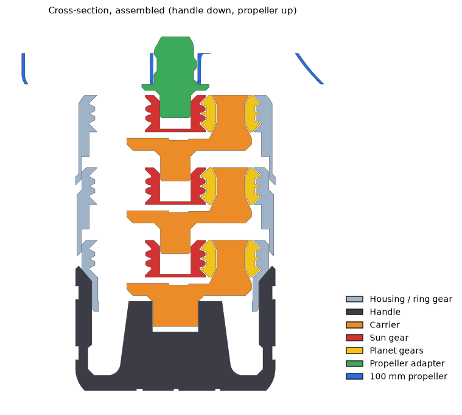
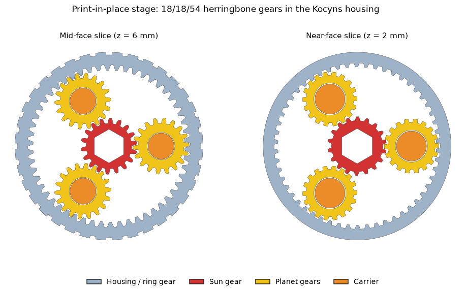

# Propeller Launcher — 3D printing

A hand-powered launcher for 3D-printed propellers. It is a three-stage planetary gearbox that spins the propeller at **64×** the speed of your hand. Hold the handle, twist the ribbed housing sharply, and the propeller lifts off the top.

This repository holds two upstream launcher designs, unchanged, and a **hybrid** that combines the best parts of both.

<p align="center">
  
</p>

## The hybrid launcher

[`Custom_HybridLauncher/`](Custom_HybridLauncher/) starts from the Kocyns launcher and merges in features from the Lukas Hannert one:

| From Kocyns | From Lukas Hannert |
|---|---|
| Print-in-place gear stages: every stage comes off the printer fully assembled | Herringbone gear teeth, which mesh smoothly and lock themselves axially |
| Overall size (Ø 65 mm, ~115 mm tall) and the snap-on handle | The coned, splined adapter nose, so the propeller drops straight on |
| | The 100 mm toroidal propeller |

<p align="center">
  
</p>

Each stage is an 18/18/54 herringbone planetary (4:1). It keeps the Kocyns 45° retention cones and printed-in carrier pins, so nothing needs assembling inside a stage. The handle carries an engraved B3D Labs logo.

### Print it

| File | Qty |
|---|---|
| `Coupon_Clearance_0.15.stl`, `_0.20.stl`, `_0.25.stl` | print these first: test gear sets that check your printer's tolerance |
| `Stage1_PropEnd_PIP.stl`, `Stage2_Middle_PIP.stl`, `Stage3_HandleEnd_PIP.stl` | 1 each |
| `Handle_B3D.stl`, `Propeller_Adapter.stl` | 1 each |
| `Propeller_100mm.stl` | 1 or more |

Use a 0.4 mm nozzle and 0.2 mm layers, with no supports. Print each part in the orientation of its file. Print settings, how to choose a clearance, and the assembly order are in [`Custom_HybridLauncher/README.md`](Custom_HybridLauncher/README.md).

### See it move

[`Custom_HybridLauncher/Assembly.glb`](Custom_HybridLauncher/Assembly.glb) is the assembled launcher with a looping animation. The handle makes one turn, and every carrier, gear and the propeller follow the real gear ratios. The housings are translucent so you can watch the gear train.

Open it in any glTF viewer that plays animations, such as [Babylon.js Sandbox](https://sandbox.babylonjs.com), [glTF Viewer](https://gltf-viewer.donmccurdy.com), Blender, or Windows 3D Viewer.

### Rebuild or tweak it

The hybrid STLs are generated from the original files by Python scripts in [`Custom_HybridLauncher/src/`](Custom_HybridLauncher/src/). Gear clearance, helix angle and tooth count are parameters at the top of `build.py`. You need `trimesh`, `manifold3d`, `shapely` and `numpy`.

```
python Custom_HybridLauncher/src/build.py     # generate all STLs
python Custom_HybridLauncher/src/check.py     # verify: watertight, no fused parts, gears mesh, parts fit
python Custom_HybridLauncher/src/assemble.py  # generate the animated Assembly.glb
```

## Repository layout

| Path | Contents |
|---|---|
| [`Original_Kocyns/`](Original_Kocyns/) | Upstream Kocyns launcher, unchanged: handle, three print-in-place stages, propeller pin, toroidal propellers (100 / 150 mm). File names are the original Czech ones. |
| [`Original_LukasHannert/`](Original_LukasHannert/) | Upstream Lukas Hannert launcher, unchanged: a three-stage planetary with separately printed gears, housings, shafts and two propellers (100 / 67.4 mm). |
| [`Custom_HybridLauncher/`](Custom_HybridLauncher/) | The hybrid design: STLs, animated assembly, generator scripts and README. |
| `B3D_Labs.svg` | B3D Labs logo, engraved into the hybrid handle. |
| `docs/` | Images for this README. |

## Cloning

The STL and GLB files are stored with **Git LFS** (about 680 MB in total). Install [Git LFS](https://git-lfs.com) before cloning, or you will get small pointer files instead of models. To download only the hybrid design:

```
GIT_LFS_SKIP_SMUDGE=1 git clone https://github.com/shivamchudasama/PropellerLauncher_3DPrinting.git
cd PropellerLauncher_3DPrinting
git lfs pull --include="Custom_HybridLauncher/*"
```

## Credits

The `Original_*` directories hold the designs of **Kocyns** and **Lukas Hannert**, exactly as published. All credit for those designs, and their licence terms, belong to their authors; check the original listings before redistributing them. The hybrid design, scripts and branding are by B3D Labs.
